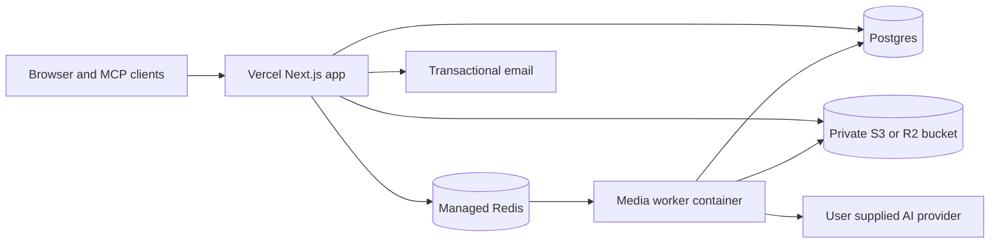

# Cloud production readiness and Vercel setup

Kavero can run its web application on Vercel. The production service is a small set of cooperating runtimes: Vercel handles web/API requests, Postgres owns durable application state, Redis owns shared state and the media queue, private S3-compatible storage owns files, and a separate container consumes long-running media jobs.



## Runtime boundaries

| Runtime | State and storage | AI/MCP behavior | Limits and operations |
| --- | --- | --- | --- |
| Desktop | Browser IndexedDB, embedded PGlite, local filesystem; Redis is optional | Local account and local network behavior | Offline-first and unlimited local entitlements |
| Self-hosted | Postgres or PGlite, optional Redis, filesystem or S3-compatible storage | Operator model plus personal keys; MCP API keys remain available | No Kavero billing; persistent volumes and backups are the operator's responsibility |
| Cloud | Postgres, required shared Redis, required private S3-compatible storage | Users bring their own AI keys; MCP remains available with Kavero API keys; cloud server-funded AI is disabled | Workspace entitlements are enforced; payment processing is not implemented |

Every user receives a personal workspace and it is the default workspace. Catalogs, shared media deduplication, storage reservations, media jobs and quota lookups are associated with a workspace. Team workspaces therefore share the workspace's limits. Entitlements resolve by workspace ID so a future subscription provider can map a plan to a workspace without changing user identity or catalog ownership.

## What is implemented

- `@upstand/redis@1.0.0` is the Redis dependency behind Kavero's cache, shared rate limiters, Better Auth secondary storage and media queue. Cloud rate limits and auth state fail closed when Redis is unavailable.
- `@circulo-ai/upload@2.0.2` supplies the local and S3 storage providers. Browser uploads use five-minute create-only S3 presigned URLs, temporary per-upload keys, server-side object verification and immutable workspace/hash keys. The database reservation remains for six minutes, and catalog/workspace deletion waits for active signed URLs to expire; canceled upload rows stay available to the worker until staging cleanup is safe. Local and self-hosted storage use a bounded server upload route. Published media, MCP imports and normal catalog assets use the same workspace/hash deduplication rule.
- Image/video job rows are durable in Postgres. Queue messages contain only the job ID; the worker obtains the user's encrypted provider key when it runs. This keeps provider secrets out of Redis and out of browser requests.
- Vercel requests do not run the persistent queue consumer. The worker is the `worker` target in `apps/web/Dockerfile`; it can run beside the app in Docker Compose or as a separate container service.
- PDF, image and MCP preview rendering use Playwright. Vercel uses `@sparticuz/chromium`; Docker uses its installed Chromium. Vercel delivers completed PDF/ZIP exports through short-lived signed links to the private bucket, keeping large responses out of function responses.
- Vercel MP4 export is deliberately disabled. Its current job tracker and output files are process-local; the durable media worker handles AI generation jobs, not MP4 renders. The editor explains this and the API rejects requests instead of returning jobs that may disappear.
- Cloud signup requires email verification and password recovery. New signups default to closed until the configured `KAVERO_BOOTSTRAP_ADMIN_EMAIL` creates the first admin and an admin explicitly opens or invites signups. There is no first-signup-wins administrator behavior.
- `KAVERO_EDITION=cloud` requires Redis, a dedicated encryption key, an S3 bucket, a bootstrap admin email and Resend credentials before the web process starts.

## What is not implemented

- Stripe or another payment provider, checkout, invoices, paid plan assignment, or automatic billing webhooks. The cloud Plan Limits screen sets default limits for every workspace; those are operator-managed defaults, not billable subscriptions. Billing is reported as unavailable in cloud feature metadata.
- Kavero-funded model calls. Cloud AI settings hide operator model credentials, and AI jobs use the current user's own provider credential. Model/provider billing, spend caps and workspace-shared AI credentials remain future work.
- A persistent Vercel worker. The Redis consumer must run as a separate long-lived container service. A Vercel project alone will not process queued media jobs.
- Durable MP4 export jobs. Enable them on a long-lived container deployment, or add a separate durable export queue and worker before offering MP4 on Vercel.

## User actions required before production

1. **Choose a hosting plan that matches the product's use.** You have stated the initial hosted cloud rollout will be non-commercial, so the Vercel Hobby team is the selected starting point while the project remains within Vercel's personal, non-commercial terms. Choose a commercial-capable host before operating it commercially.
2. **Choose and provision infrastructure:** a managed Postgres database, a managed Redis endpoint, a private S3-compatible bucket, Resend with a verified sender domain, and a container host for the worker. The container host must be able to reach the same Postgres, Redis and S3 services as Vercel.
3. **Create production secrets directly in Vercel's Environment Variables page** and the worker host's secret store. Use unique random values for `BETTER_AUTH_SECRET` and `KAVERO_ENCRYPTION_KEY`; keep stable backups of both. Do not paste production secrets into repository files.
4. **Set the first administrator email before enabling signup.** Set `KAVERO_BOOTSTRAP_ADMIN_EMAIL` to the exact address you will use, deploy, and complete email verification. Cloud signups start closed; set workspace plan limits and choose whether to open or restrict signup from Admin → Settings.
5. **Apply database migrations before serving the new app version.** Run `bun run db:migrate` against the production database from a trusted deployment environment. The Vercel web process does not auto-migrate production databases.
6. **Deploy the `worker` Docker target** with the same runtime service URLs and encryption/auth settings. Confirm its logs show it connected and consuming `media-generation` jobs.
7. **Configure the production domain and storage CORS** before sending users through uploads or account verification.

The prepared changes are published to the public fork `mhbdev/kavero` on branches `feat/cloud-production-readiness` and `master`. The Vercel project has not been created. The import is configured for repository `mhbdev/kavero`, branch `master`, root `apps/web`, and `KAVERO_EDITION=cloud` in Production and Preview. Project creation is blocked until the Vercel GitHub App is authorized for `mhbdev/kavero`; the importer currently reports that the integration must be installed or repository access granted. Complete this in GitHub → Settings → Applications → Installed GitHub Apps → Vercel → Configure, then retry the import. Vercel restricts Hobby to personal, non-commercial use. See [Vercel's Hobby terms](https://vercel.com/legal/terms) and [commercial-use guidance](https://vercel.com/docs/limits/fair-use-guidelines). Infrastructure accounts, secrets, domain verification and production data setup remain actions in their providers' dashboards.

## Vercel project settings

Create a Vercel project from `mhbdev/kavero` and configure:

| Setting | Value |
| --- | --- |
| Framework preset | Next.js |
| Root directory | `apps/web` |
| Include files outside the root directory | Enabled, so Vercel can read the root Bun workspace and `packages/*` |
| Install command | Auto-detect the root Bun workspace and `bun.lock` |
| Build command | `bun run build` from `apps/web` |
| Output directory | Leave at the Next.js default |
| Node.js version | 24.x |

The Next config uses standalone output only outside Vercel (for the Docker image). Vercel builds its native Next.js functions. Keep the app routes on the Node.js runtime; auth, Postgres, Redis, S3 signing, Playwright and FFmpeg need Node APIs.

Vercel's function request and response payload limit is 4.5 MiB by default. Kavero limits export requests to 4 MiB there to leave room for multipart headers and document JSON. Keep `VERCEL_SUPPORT_LARGE_REQUEST_BODY` unset on Hobby: the 20 MiB request-body public beta requires the 4 GB Performance memory setting, while Hobby functions are limited to 2 GB. On a plan with that setting, Kavero caps the request at 19 MiB. This opt-in only raises inbound request limits, not response limits. PDF and image export responses are written to private S3/R2 and downloaded from a short-lived signed URL; set a bucket lifecycle rule for `exports/*` to delete temporary results after one day. See [Vercel function limits](https://vercel.com/docs/functions/limitations) and the [20 MiB request-body beta](https://vercel.com/changelog/vercel-functions-now-support-request-bodies-up-to-20mib).

Chromium rendering runs inside the function and remains subject to Vercel's plan-specific duration, memory and 250 MB uncompressed bundle limits. Hobby has a 2 GB memory ceiling; with Fluid Compute (enabled by default for new projects) its function duration can reach 300 seconds. Legacy projects without Fluid Compute are limited to 60 seconds on Hobby. Keep the default two browser slots unless memory measurements justify more, and verify the deployed function bundle and actual export sizes. MP4 export requires a long-lived host until it has a durable export worker.

Start with Preview deployments only after configuring isolated Preview database, Redis, object storage, auth URL and email settings. Do not point Preview builds at production data. Use a stable preview domain for `BETTER_AUTH_URL` if you want verification links and cookies to work there.

## Required cloud environment

Set these in Vercel Production and in the worker container environment where indicated. Secrets must be added separately in Preview if Preview deployments are enabled.

| Variable | Web | Worker | Purpose |
| --- | --- | --- | --- |
| `KAVERO_EDITION=cloud` | Yes | Yes | Selects cloud behavior and strict startup checks |
| `DATABASE_URL` | Yes | Yes | Postgres connection string; use a provider-supported pooled runtime URL |
| `REDIS_URL` | Yes | Yes | Shared Redis connection (`rediss://` for TLS endpoints) |
| `BETTER_AUTH_URL` | Yes | Yes | Canonical HTTPS app origin; used for auth and generated links |
| `BETTER_AUTH_SECRET` | Yes | Yes | Auth/session secret; keep stable across web instances and worker |
| `KAVERO_ENCRYPTION_KEY` | Yes | Yes | Dedicated key for encrypted BYOK, MCP and storage credentials; keep stable and backed up |
| `KAVERO_BOOTSTRAP_ADMIN_EMAIL` | Yes | No | Exact email allowed to receive the initial admin role |
| `RESEND_API_KEY` | Yes | No | Verification and password recovery email provider |
| `EMAIL_FROM` | Yes | No | Resend-verified sender, e.g. `Kavero <noreply@example.com>` |
| `STORAGE_DRIVER=s3` | Yes | Yes | Prevents cloud filesystem storage |
| `S3_BUCKET` | Yes | Yes | Private S3/R2 bucket |
| `S3_REGION` | Yes | Yes | `auto` for R2; otherwise provider region |
| `S3_ENDPOINT` | As needed | As needed | S3-compatible server endpoint, omitted for AWS S3 |
| `S3_PUBLIC_ENDPOINT` | When needed | No | Browser-reachable endpoint if the signing endpoint is private |
| `S3_ACCESS_KEY_ID` / `S3_SECRET_ACCESS_KEY` | As needed | As needed | Set as a pair when the runtime has no provider workload identity |
| `S3_FORCE_PATH_STYLE` | As needed | As needed | Set `true` for MinIO-compatible endpoints |
| `KAVERO_CHROME_PATH` / `FFMPEG_PATH` | No | Worker: FFmpeg path | Optional overrides; Vercel Chromium is bundled and Docker paths are configured |

Do not set `KAVERO_AUTO_MIGRATE=1` on Vercel. Apply the repository migrations as a separate, ordered deployment step. When schema changes are made, deploy additive/backward-compatible migrations before the app that requires them.

## Storage and deduplication contract

Create a private bucket and add CORS for the exact production and stable preview origins. Allow `GET` and `PUT`; allow `Content-Type`, `If-None-Match` and `x-amz-meta-sha256`; expose `ETag` if your provider requires it. Keep all signed `uploadHeaders` unchanged in the browser. Configure object lifecycle rules to remove `workspaces/*/uploads/*` staging keys, `media-jobs/*` generated results and `exports/*` temporary results after one day as a backstop; Kavero verifies and cleans normal staging uploads and expired media jobs itself.

Cloud uploads are authorized by a database reservation. The signed object goes to a unique staging key, and Kavero checks expiry, authenticated owner, size, MIME metadata, file signature and full SHA-256 before promoting it to `workspaces/{workspaceId}/assets/{sha256}`. Deduplication is workspace-scoped: matching verified hashes attach another catalog reference to the existing object. A different workspace never inherits the first workspace's storage entitlement or object namespace. MCP imports and server-side media files use the same workspace boundary.

The bucket must permit object reads, writes, deletes and signed conditional writes. Test this exact contract against your selected S3-compatible provider before enabling uploads; the package's production notes qualify MinIO, while AWS S3/R2 provider-specific CORS and conditional-write behavior must be verified in your account.

## Workspace limits, BYOK and later billing

Cloud workspace entitlements currently include catalog count, published site count, unique media bytes, and optional server-funded AI request count. Storage reservations are serialized per workspace; pending uploads and queued/generated media jobs count against their workspace. Personal workspace is used when no workspace is selected. These entitlements are not billing: no subscription record is stored today and no provider charges a customer through Kavero.

Cloud uses BYOK for text/image/video generation. Every cloud AI provider, including OpenAI-compatible endpoints, requires a user-owned API key; a server-configured provider is never used as a cloud fallback. User keys are encrypted in Postgres, loaded server-side for a job, never placed in Redis queue payloads, and never returned in full to the browser. MCP tools remain available with the user's Kavero API key and workspace/catalog permissions. When Kavero-hosted models are added later, the entitlement interface can resolve a workspace plan and apply spend/request quotas at that same workspace boundary.

## Migrations, worker, monitoring and backups

Before the first production deployment, run:

```sh
bun install --frozen-lockfile
bun run db:migrate
```

Run the worker container from this repository's root Docker context with target `worker`. It needs the same Postgres, Redis, S3 and encryption-key values as the web app, plus `FFMPEG_PATH=/usr/bin/ffmpeg` when using the supplied worker image. The image processes Redis jobs with durable database leases, retries failures and cleans expired media jobs and upload staging records.

Use `GET /api/health` as the production readiness endpoint. In cloud mode it requires Postgres, Redis, storage, Chromium and FFmpeg; it returns 503 if a required dependency is unavailable. On Vercel, verify both Chromium and the bundled FFmpeg executable are present in the function output. MP4 export remains disabled there. Alert on health failures and worker queue/dead-letter logs. Back up Postgres, object storage, `BETTER_AUTH_SECRET` and `KAVERO_ENCRYPTION_KEY` together. Restoring the database without its object storage or encryption keys can leave files or user credentials unavailable.

## Roadmap

### Launch readiness

1. Use Vercel Hobby while the hosted cloud rollout remains personal and non-commercial, or select a commercial-capable production host before commercial operation; then choose a production domain.
2. Provision Postgres, Redis, S3/R2, Resend and the worker host; enter secrets in each provider.
3. Run migrations, deploy web and worker, verify `/api/health`, sign up the configured operator and verify email.
4. Verify an upload, duplicate upload, download, workspace MCP import, BYOK text/image job, preview/PDF export, email verification and password reset against the actual production provider accounts.
5. Close or restrict signup, configure backups/alerts and set workspace defaults in Admin → System → Plan limits.

### Future commercial cloud work

1. Add a workspace subscription/plan record and billing-provider adapter to the existing `forWorkspace(workspaceId)` entitlement boundary.
2. Add checkout, invoice/tax handling, webhook signature/idempotency, subscription lifecycle and cancellation flows.
3. Add provider-funded model configuration, per-workspace spend caps, usage ledger and charge attribution before enabling Kavero-served AI.
4. Decide whether BYOK credentials remain personal or can be shared/encrypted at workspace scope; keep API-key access control and audit logs workspace-aware.
